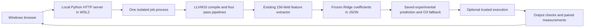

# NeuroCompiler — run and present the live decision explorer

This branch adds a working **C input → LLVM features → learned pipeline prediction
→ output checks → native comparison** application. The existing research
dashboard remains available through **Research evidence** in the navigation.
The live app is separate from the frozen research experiments.

[Checked desktop screenshot](presentation/screenshots/decision.png) ·
[Verification record](presentation/VERIFICATION.md)

For copyable C programs, exact inputs, expected outputs, and diagnostic examples,
see [DEMO_PROGRAMS.md](DEMO_PROGRAMS.md).

## Start on your Windows computer

Use **x86_64 Windows with WSL2 Ubuntu 22.04**. The browser runs on Windows; the
compiler and Python server run inside Ubuntu. Native Windows execution and
Windows-on-ARM are not supported by the pinned compiler package.

1. Open **PowerShell as Administrator** and install WSL if necessary:

   ```powershell
   wsl --install -d Ubuntu-22.04
   ```

   Restart Windows if requested. Open **Ubuntu 22.04**, finish creating its
   username/password, and run all remaining commands in that Ubuntu terminal.

2. Install the Linux prerequisites:

   ```bash
   sudo apt update
   sudo apt install -y git ca-certificates python3-venv build-essential libtinfo5
   ```

3. Download only the presentation branch into a new folder. This keeps any
   existing main-branch checkout separate and avoids the large archive branch:

   ```bash
   cd ~
   git clone --single-branch --branch presentation/live-explorer https://github.com/Dhanush-singh-g/NeuroCompiler.git NeuroCompiler-live
   cd NeuroCompiler-live
   ```

4. Run setup once:

   ```bash
   bash scripts/setup_presentation.sh
   ```

   Setup creates a separate `.presentation/venv`, installs two pinned Python
   dependencies, downloads the 95 MB CompilerGym LLVM10 runtime, verifies its
   published SHA256, and extracts only the required tools. No CompilerGym Python
   installation, npm, API key, GPU, sklearn runtime, research archive, or raw
   training dataset is needed. Allow approximately 500 MB for setup and local
   experiment artifacts. Python 3.10–3.12 is supported by this setup.

   Setup ends with a real C compilation through all four pipelines, feature
   extraction and model prediction. It does not execute submitted programs.

5. Start the app:

   ```bash
   bash scripts/start_presentation.sh
   ```

6. Keep the Ubuntu terminal open. In your **Windows browser**, enter:

   ```text
   http://localhost:8000
   ```

   Standard WSL2 localhost forwarding connects the Windows browser to the Linux
   server. If this fails, try `http://127.0.0.1:8000` and confirm the server is
   still running. Do not expose this server to a network to work around a local
   forwarding problem.

7. Stop with **Ctrl+C** in Ubuntu. Next time, only run:

   ```bash
   cd ~/NeuroCompiler-live
   bash scripts/start_presentation.sh
   ```

To update this checkout later, stop the app, run `git pull --ff-only`, and rerun
setup if the dependencies or toolchain manifest changed. It preserves the
separate research environment and your original checkout.

## A five-minute presentation

| Time | Action | What to explain |
| --- | --- | --- |
| 0:00–0:40 | Introduce the problem and four candidate pass pipelines. | A fixed compiler optimization order does not have to suit every program. This project explores learning a program-specific choice. |
| 0:40–1:40 | Choose **Prime sieve / training example**, then **Analyze & predict**. | The model extracts 156 static fields per alternative. Its prediction is made without executing the program. This familiar training example is not an unseen-program evaluation. |
| 1:40–2:20 | Show scores and **Inside the prediction**. | This is an actual frozen Ridge regressor; contributions explain its arithmetic, not the physical cause of speed. Approved deployment still uses O3. |
| 2:20–3:20 | Open **Live comparison**, confirm trusted code and run. | O0 and all pipelines must print matching output twice. Balanced paired CPU/wall measurements and an O3 self-control follow. Retain an inconclusive result honestly. |
| 3:20–4:00 | Open **LLVM IR**, change the pipeline, inspect highlighted text. | The alternatives execute real LLVM passes. Similar/identical code is an expected result; static instruction counts are not runtime labels. |
| 4:00–4:40 | Choose **Your first C input**, inspect its stdin, and analyze/run. | It reads 21 and 34 and prints 55. The application accepts program input. Such a short program should not produce a credible speedup claim. |
| 4:40–5:00 | Download the report and open **Research evidence**. | Separate a working application, training-only headroom, and the still-unproven objective of learned generalization. |

Rehearse on the presentation computer before the event. Use AC power, close
heavy background applications, and finish setup while internet is available.
Once installed, the app needs no internet. Do not retry until a favorable timing
appears, hide failures, or describe these demonstration timings as a research
replication. Download reports before restarting the server.

If the machine or live timing fails during the talk, show the static prediction,
IR view, and preserved research dashboard. Clearly call saved results recorded
evidence; do not present a recording as live execution.

## What you can input

- Paste or upload a **single self-contained C file**, up to 48 KiB, with `main`.
- Use standard C/libc and libm. No external projects, extra source files, custom
  compiler flags, file inputs, or arbitrary library links are supported.
- Supply up to 16 command-line arguments and 8 KiB of text on standard input.
  Argument parsing uses shell-like quotation but never executes a shell.
- Print a short deterministic result/checksum, exit zero, and avoid clock,
  random-device, address, or nondeterministic output. File side effects are not
  part of correctness checking.
- The **iterations descriptor** is a model input, not a workload controller.
  If your program reads a repetition count from argv, change the actual
  **arguments** too. Non-iterative programs can use descriptor zero.
- Analysis compiles but does not execute the submitted program. Native
  comparison requires the separate trusted-code checkbox.

**Run only code you trust.** This is a loopback-only local developer application,
not a service for executing strangers' code. The process limits are accident
controls, not a security sandbox. A program still has your Linux user's file
and network permissions. Do not deploy this app publicly or add a public bind
address/tunnel. Under WSL your Linux user may also reach mounted Windows files.

## Where the NeuroCompiler component is

The application does not pick the fastest measured alternative and call that
learning. It compiles all candidates **without executing them**, extracts the
same candidate transformation features as the earlier model, and predicts a
pipeline. The prediction is timestamped and saved before execution is offered.
The later candidate timing table is explicitly post-prediction exploration.

| Stage | Implementation |
| --- | --- |
| Program input | Vanilla HTML/CSS/JavaScript editor, file upload, example picker, argv/stdin, and workload descriptor. No remote assets. |
| Compile | Pinned LLVM10 frontend with `-O1 -Xclang -disable-llvm-passes`, then the original four opt pipelines and native code generation. Separate O0 output reference. No fast-math/native-CPU flags. |
| Features | Reuses the existing LLVM parser and feature functions in `src/features/transform.py`: module/main/direct-reachable metrics, relative candidate deltas, per-function deltas, binary size and input descriptors, plus choice bits. Cyclic CFG regions are not dynamic hotness or natural-loop nesting. Indirect reachability is a lower bound. |
| Predict | Exact portable JSON export of `sl_transform_policy_bundle.joblib`'s `raw_ridge1_floor0` model. Standardization, linear coefficients, intercept, margin, threshold, and O3-alias handling preserve the original decision rule. No pickle loading in the live app. |
| Explain | Largest standardized-feature × coefficient contributions. Remaining fields/intercept also contribute. Six-standard-deviation flags are extrapolation warnings, not calibrated confidence. |
| Check | Two successful executions of O0 and every candidate must have byte-identical stdout on the supplied input. A mismatch blocks timing. This does not prove semantic correctness for every possible input. |
| Measure | Twelve baseline/candidate pairs per distinct binary, three blocks, balanced starting order. Separate child CPU service time and process wall time, including startup. CPU affinity is set to one available logical CPU. Every sample is retained. |
| Interpret | Both clocks require at least 10 ms median duration per side, at most 10% within-side duration CV, and at most 3% pooled/every-block starting-order difference. The O3 null also needs its 95% paired-bootstrap interval and every block within reciprocal 3%. Failure means inconclusive. Passing controls still do not make this a formal research evaluation. |
| Inspect/export | Side-by-side IR with line-set highlighting, metrics, downloadable LLVM10 bitcode for the model choice and approved O3, Markdown summary, and complete JSON containing input, features, decisions, attributions, artifact hashes, and raw samples. Bitcode hashes are checked again at download. |

The four alternatives are **O3**, **mem2reg → loop-rotate → LICM → O3**,
**O3 → GVN → DCE**, and **instcombine → O3**. These are real pass pipelines
from the existing model's training menu; this is not an O2/O3-only comparator
or a model that invents arbitrary pass sequences. Byte-identical alternatives
are labelled aliases and share their canonical measurement.

The exported model has **39 candidate targets across seven real and six
synthetic training programs**. The exact source model and report hashes, training
program identifiers and inherited limitations are in `presentation/model.json`.
Its historical conditional CV estimate was about 1.0089×, with an interval
including 1; it failed the deployment gates. Do not present that number as an
unseen-program live result. The current approved policy remains O3.

This is the **earlier LLVM10 model**. Its O3 comparator is LLVM10's pipeline,
not LLVM19's O3 or the latest LLVM release. Later LLVM19 library studies have a
different feature contract and did not produce a qualified experimental model.
Their declarations, labels, native artifacts, models and held-out programs are
unchanged. This branch does not retrain, collect new formal labels, consume
reserved holdouts, or implement RL/hybrid learning.

## Architecture and local storage



`src/presentation/server.py` serves an explicit asset allowlist, checks loopback
Host/Origin, requires a session token for mutations, and permits only one active
job. `worker.py` handles compilation, prediction, checking and measurement.
Cancellation and server Ctrl+C terminate the active process group. Each program
has a two-second wall limit, three-second CPU limit, 768 MiB address-space limit,
64 KiB output-file limit, and disabled core dumps. A whole job has a 120-second
deadline. These limits do not isolate filesystem/network access.

The ignored `.presentation/` directory contains the separate Python environment,
verified LLVM tools, source files, bitcode, executables, logs and JSON reports.
Your submitted code is saved **locally**, included in the JSON report, and never
sent to GitHub by the app. Reports from this server session can be downloaded
through the UI. On server restart the UI starts a new session; old raw files
remain in `.presentation/runs/` for manual access. A browser refresh within the
same server session restores the latest completed analysis and its comparison.
The session permits 30 jobs before a restart.

## Troubleshooting

| Symptom | Action |
| --- | --- |
| Running commands in PowerShell fails | After WSL installation, run setup/start inside the **Ubuntu22.04** terminal. |
| `libtinfo.so.5` missing | In Ubuntu22.04 run `sudo apt install libtinfo5`. Ubuntu24.04 has different package availability; use the documented22.04 distribution. |
| `stddef.h`, headers or linker files missing | Install `build-essential`, then rerun setup. Do not point this model at a different LLVM major version. |
| Python version outside3.10–3.12 | Use Ubuntu22.04's `python3`. A separate venv is created automatically. |
| Port8000 occupied | Stop your recorded-dashboard server, or use `bash scripts/start_presentation.sh --port 8001` and open the matching port. |
| Invalid C | Compiler diagnostics appear in the page. Fix the source and analyze again. |
| Output mismatch | Fix nondeterminism/undefined behavior or inspect differing outputs. Timing is deliberately blocked. Preprocessor behavior depending on optimization level can also differ. |
| Program times out | Reduce the real repetition argument, or fix an accidental infinite loop. Cancellation is available while a job runs. |
| Short/noisy run or failed O3 null | Treat the ratio as inconclusive. A larger deterministic workload may help short programs; a quiet target is needed for reliable performance research. |
| All pipelines match O3 | LLVM produced identical native binaries. The model's alias rule keeps their scores at zero; do not manufacture a difference. |
| Source/input edited after analysis | Analyze again. Prior predictions and comparisons are cleared so they are not attached to new code. |
| Archive or tool hash mismatch | Installation/startup refuses mismatched artifacts. Download the pinned archive again; do not disable hash checks. |

## Verification

From the installed environment:

```bash
.presentation/venv/bin/python scripts/serve_presentation.py --check
.presentation/venv/bin/python -m unittest tests.test_presentation tests.test_dashboard tests.test_workspace_archive
```

The live integration tests run real compilers and small trusted programs, with
temporary test directories. Without the pinned LLVM tools, the integration class
is **skipped**, not counted as a verified native workflow. Core input/model and
measurement tests still run. The optional browser check additionally requires
Playwright and Chromium; these are development tools, not application dependencies.

The Windows/WSL installation steps require a rehearsal on your own computer.
Current cloud verification is on x86_64 Linux, not a Windows hardware test.
